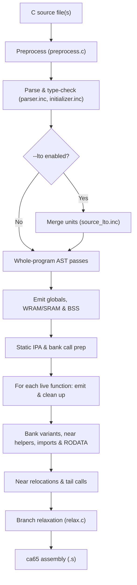
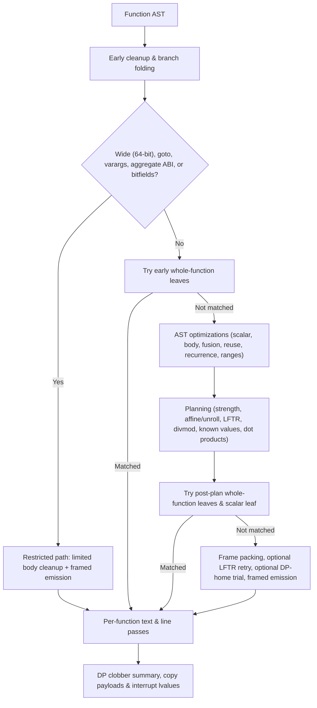
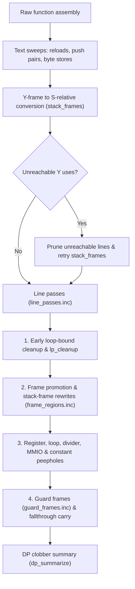

# Compiler architecture and pass pipeline

This document explains how `zicc` turns C source files into 65816 ca65 assembly.
It shows the stages in order, what each pass reads and changes, what must run
before it, and how shared state moves between stages.

For C-level examples of individual optimizations, see the
[optimization guide](../optimizations.md) and the
[optimization catalog](optimization-catalog.md). For target ABI and memory
rules, see [operations](../operations.md).

## Big picture: how the compiler is built

`zicc` compiles from three host C translation units:

- [src/main.c](../../src/main.c): CLI options, core AST/type structures, and the
  driver. It pulls in [src/parser.inc](../../src/parser.inc),
  [src/codegen/codegen.inc](../../src/codegen/codegen.inc) (which includes the
  other 57 codegen `.inc` files), and
  [src/source_lto.inc](../../src/source_lto.inc).
- [src/preprocess.c](../../src/preprocess.c): macro expansion, `#include`, and
  conditional directives (`#if` / `#ifdef`).
- [src/relax.c](../../src/relax.c): post-emission branch sizing and relaxation.

Most passes read and write typed C syntax trees (`Parser`, `Function`,
`Statement`, `Expr`). Once a function is emitted into the assembly text buffer
`cg.assembly`, later passes parse that function's text into `LpLine` records,
clean it up, and write the text back before final branch relaxation.

## Pipeline diagrams

### 1. Whole-program pipeline

### 2. Per-function pipeline

### 3. Per-function assembly cleanup pipeline

---

## Pass reference (one line per pass)

Each row below lists a pass in the order it runs, its disable flag (if any),
what it reads, what it changes, and what must run before it.

### Stage 1: Frontend and whole-program passes

| Pass | Flag | File | Reads | Changes | Must run before it |
| --- | --- | --- | --- | --- | --- |
| Preprocess | (always on) | [preprocess.c](../../src/preprocess.c) | Raw C source, `-I` headers | Produces expanded C text and `--dependencies` log | CLI option parsing |
| Parse & type-check | `--c89-keywords`, `--binary64` | [parser.inc](../../src/parser.inc), [initializer.inc](../../src/initializer.inc), [legacy_functions.inc](../../src/legacy_functions.inc) | Expanded C text | Builds `Parser` symbols, types, static initializer bytes, and function ASTs | Preprocess |
| Source LTO merge | `--lto` / `--lto-source` | [source_lto.inc](../../src/source_lto.inc) | 1..32 parsed `Parser` units | Merges symbols, types, strings, and functions into one `Parser` | Parse & type-check of every unit |
| `function_uses_wide` | (always on) | [codegen.inc](../../src/codegen/codegen.inc) | Each function's signature and AST | Sets `f->uses_wide` and rejects unsupported 64-bit constructs | Parse (and LTO merge if enabled) |
| `inline_translation_unit` | `--no-inline` | [inline.inc](../../src/codegen/inline.inc) | Call graph, function ASTs, `f->uses_wide` | Cleans simple `goto`/switch wrappers, inlines eligible calls, marks dead `static` callees `inline_omit` | `function_uses_wide` |
| `narrow_rodata_struct_arrays` | `--no-body-optimizations` | [narrow_rodata.inc](../../src/codegen/narrow_rodata.inc) | Internal `const` struct arrays and all AST reads | Shrinks 16-bit struct fields that fit in 8 bits and rewrites member reads | `inline_translation_unit` |
| `resolve_near_memcpy` | (always on) | [codegen.inc](../../src/codegen/codegen.inc) | Declared external `memcpy` symbol | Redirects near-pointer `memcpy` to `_zicc_memcpy_near` | `inline_translation_unit` |
| Global & static storage emission | (always on) | [codegen.inc](../../src/codegen/codegen.inc) | File-scope defined symbols and initializers | Emits `DATA`, `RODATA`, `BSS`, `ZEROPAGE`, `LORAM`, `RUNTIME_BSS`, WRAM, and SRAM segments | `narrow_rodata_struct_arrays`, `resolve_near_memcpy` |
| `static_ipa_prepare` | `--no-body-optimizations` | [static_ipa.inc](../../src/codegen/static_ipa.inc) | Live non-escaping `static` functions and call sites | Propagates uniform constant arguments and narrows private static parameters | `inline_translation_unit` |
| `bank_prepare` | `--no-bank-specialization` | [bank_calls.inc](../../src/codegen/bank_calls.inc) | Functions and call sites passing fixed far-pointer banks | Plans private specialized entries in `cg.banks` | `static_ipa_prepare` |

### Stage 2: Per-function AST optimization and planning

These passes run inside `emit_function()` in [codegen.inc](../../src/codegen/codegen.inc).
Functions with 64-bit wide values (`f->uses_wide`), `goto` labels, varargs,
aggregate-by-value ABI, or bitfields take restricted subsets and skip directly
to framed emission.

| Pass | Flag | File | Reads | Changes | Must run before it |
| --- | --- | --- | --- | --- | --- |
| `forward_rebuilt_record` | (always on) | [codegen.inc](../../src/codegen/codegen.inc) | Function AST | Simplifies rebuilt struct return patterns | Stage 1 whole-program passes |
| `body_project_switch_strings` | `--no-body-optimizations` | [body_opt.inc](../../src/codegen/body_opt.inc) | Top-level block AST | Projects constant string accesses out of switches | `forward_rebuilt_record` |
| `body_drop_unused_homes` | (always on) | [body_opt.inc](../../src/codegen/body_opt.inc) | Function AST and local slots | Compacts unused local stack slots | `body_project_switch_strings` |
| `body_drop_empty_loops` | `--no-loop-unroll` | [body_opt.inc](../../src/codegen/body_opt.inc) | Structured loops in AST | Removes provably empty non-volatile loops | `body_drop_unused_homes` |
| Wide-function mini-flow & `narrow_statements` | `--no-body-optimizations` | [body_opt.inc](../../src/codegen/body_opt.inc), [codegen.inc](../../src/codegen/codegen.inc) | Wide-function AST (`f->uses_wide`) | Runs `body_flow`, `body_dead_locals`, and narrows wide ops back to 16/32-bit when safe | `body_drop_empty_loops` |
| `body_simplify_branches` | `--no-body-optimizations` | [body_opt.inc](../../src/codegen/body_opt.inc) | Conditional branches in AST | Folds constant tests and simplifies branch structure | Wide mini-flow (if wide) |
| `copy_prepare` | `--no-copy-selection` | [aggregate_copy.inc](../../src/codegen/aggregate_copy.inc) | Aggregate/string copy expressions in AST | Marks copy plans and literal string uses | `body_simplify_branches` |
| Early whole-function leaves | `--no-strength-reduction` | [codegen.inc](../../src/codegen/codegen.inc), [range_scans.inc](../../src/codegen/range_scans.inc), [guarded_updates.inc](../../src/codegen/guarded_updates.inc), [counted_reductions.inc](../../src/codegen/counted_reductions.inc) | Non-volatile, non-inlined function AST | Emits a complete frameless leaf (`word_shift_scan_leaf`, `range_scan_leaf`, `guarded_update_leaf`, `guarded_byte_lookup_leaf`, `counted_reduction`) and returns early | `copy_prepare` |
| `scalar_propagate` | `--no-body-optimizations` | [scalar_values.inc](../../src/codegen/scalar_values.inc) | Function AST and local scalars | Propagates dominating copies/constants and forwards single-use temporaries | Early leaf checks |
| `body_optimize` | `--no-body-optimizations` | [body_opt.inc](../../src/codegen/body_opt.inc) | Function AST | Normalizes counted loops, runs flow-sensitive copy/const propagation, flattens blocks, removes dead locals and covered stores | `scalar_propagate` |
| `body_keep_clamps` | `--no-value-reuse` | [body_opt.inc](../../src/codegen/body_opt.inc) | Normalized function AST | Preserves clamp patterns for branchless selection | `body_optimize` |
| `body_split_xor_loops` | `--no-loop-unroll` | [body_opt.inc](../../src/codegen/body_opt.inc) | Normalized loops | Splits eligible XOR loops into cleaner forms | `body_keep_clamps` |
| `loop_fusion_prepare` | `--no-body-optimizations` | [loop_fusion.inc](../../src/codegen/loop_fusion.inc) | Adjacent counted loops and memory effects | Fuses compatible loops that share bounds and have safe aliasing | `body_split_xor_loops` |
| `body_shared_selections` | `--no-body-optimizations` | [body_opt.inc](../../src/codegen/body_opt.inc) | Conditional assignments | Merges selections that test the same predicate | `loop_fusion_prepare` |
| `value_reuse_prepare` | `--no-value-reuse` | [value_reuse.inc](../../src/codegen/value_reuse.inc) | Function AST | Binds dominated repeated pure expressions and comparisons to temporaries | `body_shared_selections` |
| `body_reuse_addresses` | `--no-body-optimizations` | [body_opt.inc](../../src/codegen/body_opt.inc) | Function AST | Reuses repeated base-address calculations across statements | `value_reuse_prepare` |
| `body_order_homes` | `--no-body-optimizations` | [body_opt.inc](../../src/codegen/body_opt.inc) | Local scalar slots | Reorders local home offsets to improve packing and locality | `body_reuse_addresses` |
| `value_recurrences_prepare` | `--no-body-optimizations` | [value_recurrence.inc](../../src/codegen/value_recurrence.inc) | Loop bodies and scalar updates | Rewrites exact modular recurrences and coalesces dead copied homes | `body_order_homes` |
| `body_byte_ranges` | `--no-known-values` | [body_opt.inc](../../src/codegen/body_opt.inc) | Loop bounds and byte accesses | Annotates byte-range facts for downstream narrowing | `value_recurrences_prepare` |
| `forward_return` | (always on) | [codegen.inc](../../src/codegen/codegen.inc) | Non-volatile function AST | Simplifies tail return assignments | `body_byte_ranges` |
| `recursive_word_product` | `--no-strength-reduction` | [recursive_products.inc](../../src/codegen/recursive_products.inc) | Function AST | Emits a specialized frameless leaf for widened `word * self_call()` recursion | `forward_return` |
| `strength_prepare` | `--no-strength-reduction` | [strength.inc](../../src/codegen/strength.inc) | Loops and indexed array accesses | Populates `cg.cursors` with running pointer cursors for invariant bases | `forward_return` |
| `affine_prepare` (+ `loop_unroll.inc`, prune, compact) | `--no-strength-reduction`, `--no-loop-unroll` | [affine_loops.inc](../../src/codegen/affine_loops.inc), [loop_unroll.inc](../../src/codegen/loop_unroll.inc) | Loops, `cg.cursors`, local slots | Populates `cg.affine` with running addresses and costed unroll plans; prunes redundant cursors and dead indices | `strength_prepare` |
| `lftr_prepare` | `--no-index-elimination` | [lftr.inc](../../src/codegen/lftr.inc) | `cg.cursors` and loop termination tests | Populates `cg.lftr` with candidate C index variables to eliminate | `affine_prepare` |
| `divmod_prepare` | `--no-divmod-reuse` | [divmod.inc](../../src/codegen/divmod.inc) | Pure scalar `/` and `%` pairs in AST | Populates `cg.divmod` to reuse hardware/helper quotient and remainder | `lftr_prepare` |
| `known_prepare` (+ `range_values.inc`) | `--no-known-values` | [known_values.inc](../../src/codegen/known_values.inc), [range_values.inc](../../src/codegen/range_values.inc) | Function AST and constant initializers | Runs bounded abstract ranges (`rv_*`) then flow-sensitive known-bits/range proofs; annotates `e->known` and `e->known_no_conversion` | `divmod_prepare` |
| `dot_products_prepare` | `--no-strength-reduction` | [dot_products.inc](../../src/codegen/dot_products.inc) | Loops and signed-byte products | Populates `cg.dots` / `cg.dot_packs` for loop-invariant coefficient packing | `known_prepare` |
| Post-plan whole-function leaves | `--no-register-loops` | [far_loops.inc](../../src/codegen/far_loops.inc), [indexed_far_loops.inc](../../src/codegen/indexed_far_loops.inc), [register_loops.inc](../../src/codegen/register_loops.inc), [word_expr.inc](../../src/codegen/word_expr.inc), [wide.inc](../../src/codegen/wide.inc), [entry_cursors.inc](../../src/codegen/entry_cursors.inc) | Planned AST and `cg` plans | Emits a complete frameless leaf (`far_loop_leaf`, `predicate_loop_leaf`, `indexed_loop_leaf`, `register_loop_leaf`, `word_leaf`, `word_expression_leaf`, `wide_leaf`, `entry_cursor_leaf`, `entry_cursor_nested_leaf`) if matched | `dot_products_prepare` |
| `scalar_leaf` | (always on) | [codegen.inc](../../src/codegen/codegen.inc) | Simple leaf AST without calls or frames | Emits a frameless register-only function body | Post-plan leaves |
| `plan_register_homes` & `compact_parameter_reservations` | (always on) | [codegen.inc](../../src/codegen/codegen.inc) | Parameter uses in AST | Sets `cg.register_homes`, `cg.register_spills`, and trims unused stack parameter space | `scalar_leaf` |
| `pack_private_frame` | (always on) | [frame_packing.inc](../../src/codegen/frame_packing.inc) | Local scalar liveness in AST | Colors non-overlapping private slots into `cg.frame_map` and sets `cg.frame_saved` | `compact_parameter_reservations` |
| Speculative LFTR retry | `--no-index-elimination` | [codegen.inc](../../src/codegen/codegen.inc), [lftr.inc](../../src/codegen/lftr.inc) | `cg.lftr` and saved `Codegen` snapshot | Tries emitting with `cg.lftr_active = 1`; rolls back `cg` and re-emits if any eliminated index is referenced | `pack_private_frame` |
| `dp_homes_function` | `--no-dp-homes` | [dp_homes.inc](../../src/codegen/dp_homes.inc) | Trial assembly, helper clobbers, `dp_summaries` | Speculatively maps hot frame words into unused DP scratch `$02..$21` and re-emits if verified | `pack_private_frame` |
| `emit_function_frame` | (always on) | [codegen.inc](../../src/codegen/codegen.inc) | Function AST and all `cg` plans | Emits prologue, statements, loops, expressions, epilogue, and interrupt scratch hooks into `cg.assembly` | `pack_private_frame` (and DP/LFTR trials) |

### Stage 3: Loop and expression emitters (called during `emit_function_frame`)

Inside `emit_function_frame()`, loops enter `emit_loop()` and `emit_loop_body()`
in strict priority order (first match wins). Expression and statement lowering
also dispatch to focused helper modules.

| Emitter / helper | Flag | File | Reads | Changes | Must run before it |
| --- | --- | --- | --- | --- | --- |
| `region_enter` / `region_exit` | `--no-region-homes` | [region_homes.inc](../../src/codegen/region_homes.inc) | Loop liveness and DP scratch usage | Temporarily caches hot loop variables in direct-page scratch around a loop | `dp_homes_function` / `emit_function_frame` |
| `emit_scaled_ring_loop` & `emit_guard_y_loop` | `--no-loop-index-retention` | [index_retention.inc](../../src/codegen/index_retention.inc), [codegen.inc](../../src/codegen/codegen.inc) | Loop AST | Emits specialized scaled-ring or Y-guarded loops before `emit_loop_body` | `region_enter` |
| Early loop matchers (fold, far doubling, shift recurrence, byte copy/sum/mask) | `--no-strength-reduction`, `--no-loop-unroll` | [codegen.inc](../../src/codegen/codegen.inc), [shift_recurrence.inc](../../src/codegen/shift_recurrence.inc), [byte_loop_regions.inc](../../src/codegen/byte_loop_regions.inc) | Loop AST and `cg.affine` | Emits closed-form updates, unrolled far sums, shift recurrences, or byte-loop kernels | `emit_loop` entry |
| Affine / register / numeric / structured byte / retained loops | `--no-register-loops`, `--no-loop-index-retention`, `--no-register-cursors` | [affine_loops.inc](../../src/codegen/affine_loops.inc), [register_loops.inc](../../src/codegen/register_loops.inc), [numeric_loops.inc](../../src/codegen/numeric_loops.inc), [byte_loop_regions.inc](../../src/codegen/byte_loop_regions.inc), [index_retention.inc](../../src/codegen/index_retention.inc) | Loop AST, `cg.affine`, `cg.cursors`, `e->known` | Emits register-resident cursor, counter, byte-region, or retained-index loops | Early loop matchers |
| Generic loop with `dp_counter_plan` & `bound_enter` | `--no-dp-counters`, `--no-register-cursors` | [dp_counters.inc](../../src/codegen/dp_counters.inc), [bound_cursors.inc](../../src/codegen/bound_cursors.inc), [codegen.inc](../../src/codegen/codegen.inc) | Loop AST, `cg.affine`, `cg.bound_pending` | Emits general loop using DP countdown counter and/or X-held bound cursor | Specialized loop matchers |
| Expression & statement helpers | `--no-indexed-operands`, `--no-byte-shuffles`, `--no-store-fusion`, `--no-direct-dpage`, `--no-indexed-dpage`, `--no-copy-selection` | [wide.inc](../../src/codegen/wide.inc), [word_expr.inc](../../src/codegen/word_expr.inc), [word_shifts.inc](../../src/codegen/word_shifts.inc), [indexed_operands.inc](../../src/codegen/indexed_operands.inc), [dpage_access.inc](../../src/codegen/dpage_access.inc), [far.inc](../../src/codegen/far.inc), [selections.inc](../../src/codegen/selections.inc), [product_sums.inc](../../src/codegen/product_sums.inc), [shared_elements.inc](../../src/codegen/shared_elements.inc), [store_fusion.inc](../../src/codegen/store_fusion.inc), [byte_regions.inc](../../src/codegen/byte_regions.inc), [word_rows.inc](../../src/codegen/word_rows.inc), [switch.inc](../../src/codegen/switch.inc), [aggregate_copy.inc](../../src/codegen/aggregate_copy.inc), [near_libcalls.inc](../../src/codegen/near_libcalls.inc) | Expression/statement AST and `e->known` | Emits targeted 65816 sequences for 32/64-bit ops, word trees, XBA shifts, direct indexed operands, `__dpage` / far pointers, min/max, switches, MVN copies, and near stdlib calls | Stage 2 planning passes |

### Stage 4: Per-function post-emission assembly passes

These run in `emit_program()` right after `emit_function(f)` finishes writing
the function into `cg.assembly[at..cg.length]`.

| Pass | Flag | File | Reads | Changes | Must run before it |
| --- | --- | --- | --- | --- | --- |
| `drop_reloads` | (always on; skipped if volatile) | [codegen.inc](../../src/codegen/codegen.inc) | Function assembly text | Deletes `lda X` right after `sta X` on private storage when flags are dead | `emit_function` |
| `drop_push_pairs` | (always on) | [codegen.inc](../../src/codegen/codegen.inc) | Function assembly text | Removes redundant `pha`/`pla` pairs when A and flags are preserved or overwritten | `drop_reloads` |
| `merge_byte_stores` | (always on) | [codegen.inc](../../src/codegen/codegen.inc) | Function assembly text | Keeps consecutive constant 8-bit stores inside a single `sep #$20` / `rep #$20` block | `drop_push_pairs` |
| `stack_frames` (+ `lp_prune_before_frames` retry) | `--no-stack-frames` | [codegen.inc](../../src/codegen/codegen.inc), [assembly_lines.inc](../../src/codegen/assembly_lines.inc), [line_passes.inc](../../src/codegen/line_passes.inc) | Function assembly lines and stack depth CFG | Converts Y-relative frame accesses (`n,y`) into direct stack-relative accesses (`n,s`) and drops Y setup; retries once if unreachable Y uses are pruned | `merge_byte_stores` |
| `line_passes` (ordinary & interrupt) | `--no-line-passes`, `--no-private-regions`, `--no-value-reuse`, `--no-index-elimination` | [line_passes.inc](../../src/codegen/line_passes.inc) | Function assembly text parsed into `LpUnit` | Runs ~100 ordered micro-passes in 4 phases (see sub-modules below) | `stack_frames` |
| `lp_cleanup` sub-modules (inside `line_passes`) | `--no-line-passes`, `--no-private-regions` | [private_values.inc](../../src/codegen/private_values.inc), [private_regions.inc](../../src/codegen/private_regions.inc), [accumulator_cfg.inc](../../src/codegen/accumulator_cfg.inc), [region_register_values.inc](../../src/codegen/region_register_values.inc) | `LpUnit` CFG and liveness | Forwards private values/constants, removes dead stores, tracks A/X must-availability across CFG joins, and cleans scratch copies | `stack_frames` |
| Frame promotion & guard frames (inside `line_passes`) | `--no-line-passes` | [frame_regions.inc](../../src/codegen/frame_regions.inc), [guard_frames.inc](../../src/codegen/guard_frames.inc) | `LpUnit` frame accesses and call sites | Promotes Y frames to direct page or registers (`lp_y_promote`, `lp_call_frame_homes`, `lp_pointer_frame_home`, `lp_leaf_stack_arguments`, `lp_closed_frame`) and delays/removes guarded frame setup | Initial `lp_cleanup` round |
| `lp_carry_on_fallthrough` (last in `line_passes`) | `--no-line-passes` | [line_passes.inc](../../src/codegen/line_passes.inc) | `LpUnit` branch/carry flags | Removes redundant `clc`/`sec` when fallthrough guarantees carry state | All arithmetic line peepholes |
| `lp_wide_runtime_exit` (wide functions only) | `--no-line-passes` | [line_passes.inc](../../src/codegen/line_passes.inc) | Wide-function assembly (`f->uses_wide`) | Cleans jumps to runtime exits and repeated FP inexact raises without touching 64-bit return workspace | `emit_function` (wide path) |
| `dp_summarize` | `--no-dp-summaries` | [dp_homes.inc](../../src/codegen/dp_homes.inc) | Final function assembly | Records which DP scratch words `$02..$21` this function writes into `dp_summaries` for later callers in the same TU | `line_passes` (or `lp_wide_runtime_exit`) |
| `emit_block_copy_payloads` | (always on) | [codegen.inc](../../src/codegen/codegen.inc) | `; block copy payload` markers in function text | Appends inline `.byte` payload tables after the function's return | `dp_summarize` |
| `interrupt_statement_lvalues` | (always on; interrupts only) | [codegen.inc](../../src/codegen/codegen.inc) | Interrupt function AST | Emits `; interrupt lvalue _name` comments for the ROM linker/allocator | `emit_block_copy_payloads` |

### Stage 5: Whole-program assembly finalization

| Pass | Flag | File | Reads | Changes | Must run before it |
| --- | --- | --- | --- | --- | --- |
| `bank_emit` | `--no-bank-specialization` | [bank_calls.inc](../../src/codegen/bank_calls.inc) | Used entries in `cg.banks` | Emits private bank-specialized helper functions | All functions emitted |
| `emit_near_library` | (always on) | [near_libcalls.inc](../../src/codegen/near_libcalls.inc) | `cg.near_strcmp`, `cg.need_smul8`, `cg.need_pack_coeff` | Emits internal unit-local helper routines when referenced | `bank_emit` |
| Imports, assertions & RODATA strings | (always on) | [codegen.inc](../../src/codegen/codegen.inc) | Symbol `used` flags, `cg.helpers`, `cg.assembly`, `p->strings` | Emits `.import`/`.importzp`, WRAM/SRAM/DP/LoRAM `.assert` checks, and suffix-shared string literals | `emit_near_library` |
| `near_relocations` | `--long-calls`, `--long-return` | [codegen.inc](../../src/codegen/codegen.inc) | Complete `cg.assembly` text | Rewrites eligible `jsr`+`rts` pairs to tail `jmp`, and applies `--long-calls` / `--long-return` conversions | Imports & RODATA emitted |
| `relax_assembly` | `--no-branch-relaxation` | [relax.c](../../src/relax.c) | Complete `cg.assembly` text | Measures instruction sizes in `CODE`, converts out-of-range short branches into `brl` or inverted-branch + `jmp`, and writes the final `.s` file | `near_relocations` |

---

## Shared state (`cg`) ownership map

Most codegen files read and write a single static `Codegen cg` struct defined at
the top of [src/codegen/codegen.inc](../../src/codegen/codegen.inc#L54-L97).
Grouping its fields by lifetime shows where state boundaries actually live:

| Group | Fields in `cg` | Lifetime | Written by | Read by |
| --- | --- | --- | --- | --- |
| Unit & output buffer | `parser`, `assembly`, `length`, `capacity`, `label`, `inline_label`, `helpers`, `helper_count`, `arithmetic`, `require_float_format`, `require_int64_format`, `near_strcmp`, `need_smul8`, `need_pack_coeff` | Whole translation unit | `emit_program`, `code()`, `helper()`, emitters | All emitters, `dp_homes.inc`, `line_passes.inc`, `near_relocations` |
| Bank variants | `banks`, `bank_count` | Whole translation unit | `bank_prepare`, call sites (`used = 1`) | `bank_emit` |
| Current function & control flow | `function`, `loop_start`, `loop_end`, `loop_count`, `switch_depth`, `jump_base`, `interrupt_scratch` | One function | `emit_function`, `emit_function_frame`, `emit_loop`, `switch.inc` | Statement/expression emitters, interrupt scratch inserter |
| Frame & parameter layout | `frame_map`, `frame_saved`, `omitted_parameters`, `omitted_parameter_count`, `register_homes`, `register_spills`, `stack_leaf`, `stack_bias`, `scalar_first`, `scalar_leaf`, `scalar_spill`, `leaf_count` | One function | `plan_register_homes`, `compact_parameter_reservations`, `pack_private_frame`, `scalar_leaf` | `frame_offset()`, `emit_function_frame`, expression emitters |
| DP home allocation | `dp_homes`, `dp_frameless`, `dp_trial`, `dp_failed`, `dp_byte_operand`, `dp_words`, `dp_incoming_base`, `dp_zero_stack`, `dp_map`, `dp_weight` | One function (or trial) | `dp_homes.inc`, `region_homes.inc` | `frame_operand()`, `emit_function_frame` |
| Loop & arithmetic plans | `cursors`, `cursor_count`, `affine`, `affine_active`, `affine_count`, `dead_indices`, `dead_index_count`, `divmod`, `divmod_count`, `divmod_available`, `divmod_version`, `divmod_wide_version`, `dots`, `dot_count`, `dot_packs`, `dot_pack_count`, `lftr`, `lftr_count`, `lftr_active`, `lftr_failed` | One function | `strength.inc`, `affine_loops.inc`, `divmod.inc`, `dot_products.inc`, `lftr.inc` | `emit_function`, `emit_loop_body`, expression emitters |
| Active loop lowering state | `retained_*`, `scaled_ring_*`, `numeric_*`, `bound*`, `fixed_rows`, `scan_cursor`, `scan_failed`, `loop_y_borrowed` | One active loop | `index_retention.inc`, `numeric_loops.inc`, `bound_cursors.inc`, `word_rows.inc`, `codegen.inc` | Active loop body emitters |
| Line-pass function hints | `lp_volatile`, `lp_frame_address`, `lp_word_result`, `lp_value_result` | One `line_passes()` call | `line_passes`, `lp_wide_runtime_exit` | Micro-passes in `line_passes.inc` and its sub-includes |

Two other static globals exist outside `cg`:
- `inl` in [src/codegen/inline.inc](../../src/codegen/inline.inc) (owned only during `inline_translation_unit`).
- `dp_summaries` / `dp_summary_count` in [src/codegen/dp_homes.inc](../../src/codegen/dp_homes.inc) (accumulated across functions in the translation unit).
